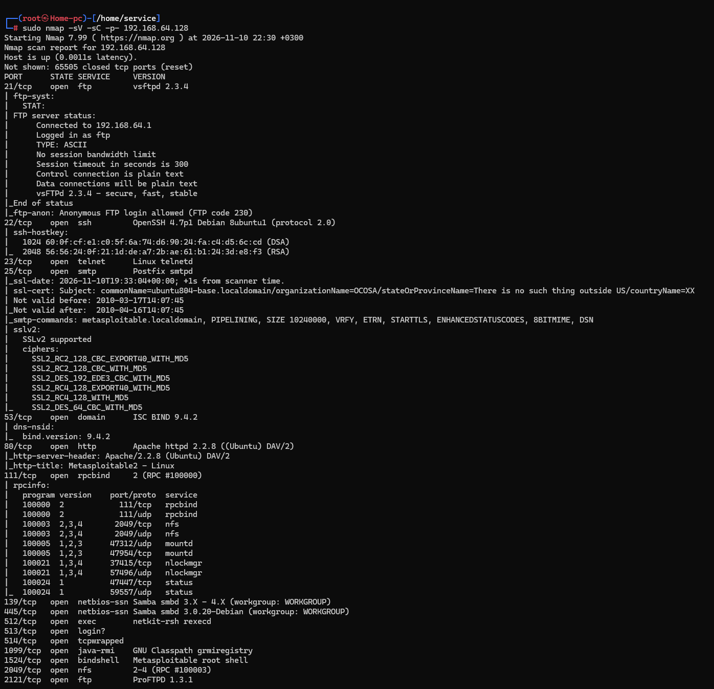
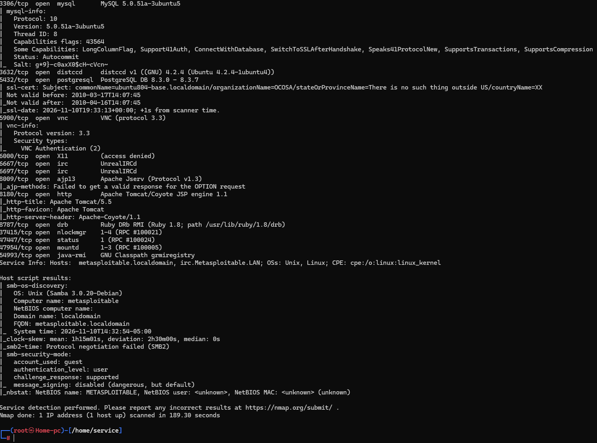
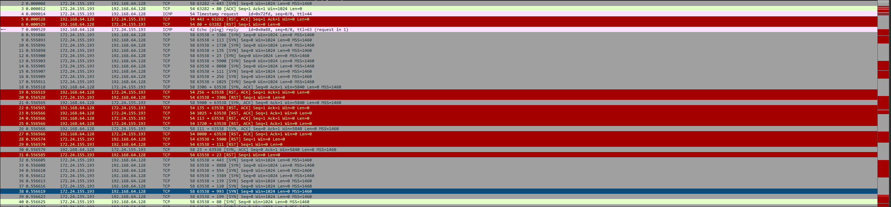
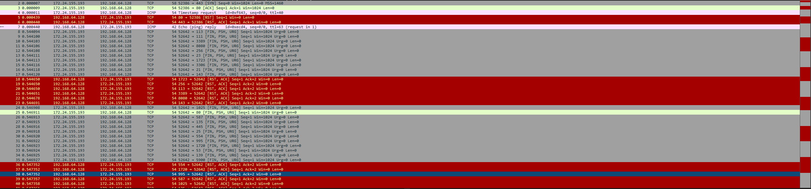
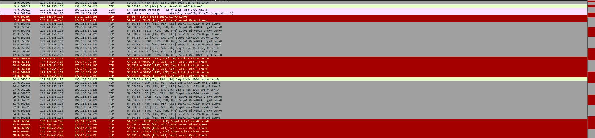
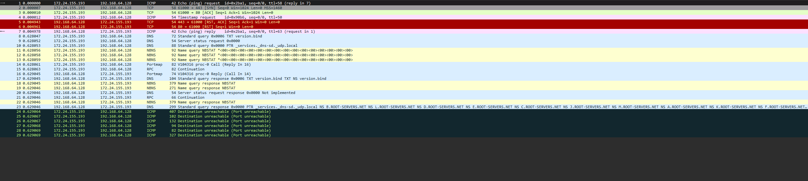

# Домашнее задание к занятию "`Уязвимости и атаки на информационные системы`" - `Сидоренко Алексей`

---

### Задание 1

`Скачайте и установите виртуальную машину Metasploitable: https://sourceforge.net/projects/metasploitable/.

Это типовая ОС для экспериментов в области информационной безопасности, с которой следует начать при анализе уязвимостей.

Просканируйте эту виртуальную машину, используя nmap.

Попробуйте найти уязвимости, которым подвержена эта виртуальная машина.

Сами уязвимости можно поискать на сайте https://www.exploit-db.com/.

Для этого нужно в поиске ввести название сетевой службы, обнаруженной на атакуемой машине, и выбрать подходящие по версии уязвимости.

Ответьте на следующие вопросы:

Какие сетевые службы в ней разрешены?
Какие уязвимости были вами обнаружены? (список со ссылками: достаточно трёх уязвимостей)
Приведите ответ в свободной форме.`

## Решение 1:

### Какие сетевые службы в ней разрешены?
В результате полного сканирования (`nmap -sV -sC -p- 192.168.64.128`) были обнаружены следующие основные сетевые службы:
- **21/tcp**: FTP (vsftpd 2.3.4)
- **22/tcp**: SSH (OpenSSH 4.7p1 Debian)
- **23/tcp**: Telnet (Linux telnetd)
- **25/tcp**: SMTP (Postfix smtpd)
- **53/tcp**: DNS (ISC BIND 9.4.2)
- **80/tcp**: HTTP (Apache httpd 2.2.8)
- **111/tcp**: RPC (rpcbind)
- **139/tcp, 445/tcp**: SMB/NetBIOS (Samba smbd 3.0.20-Debian)
- **1524/tcp**: Bindshell (Metasploitable root shell)
- **2121/tcp**: FTP (ProFTPD 1.3.1)
- **3306/tcp**: MySQL (5.0.51a-3ubuntu5)
- **3632/tcp**: Distcc (distccd v1)
- **5432/tcp**: PostgreSQL (8.3.0 - 8.3.7)
- **5900/tcp**: VNC (protocol 3.3)
- **6667/tcp**: IRC (UnrealIRCd)
- **8180/tcp**: HTTP (Apache Tomcat 5.5)

### Какие уязвимости были вами обнаружены?
На основе выявленных версий служб были найдены следующие критические уязвимости:

1. **vsftpd 2.3.4 Backdoor Command Execution**  
   **Описание:** В эту версию FTP-сервера был внедрен бэкдор, позволяющий выполнить произвольные команды с правами root, если в имени пользователя содержится смайлик `:)`.  
   **Ссылка:** https://www.exploit-db.com/exploits/17491

2. **Samba 3.0.20 Username Map Script Command Execution**  
   **Описание:** Уязвимость в конфигурации Samba позволяет выполнить произвольную команду от имени root, передав специальную строку с символами интерпретатора в поле имени пользователя при аутентификации.  
   **Ссылка:** https://www.exploit-db.com/exploits/16320

3. **UnrealIRCd 3.2.8.1 Backdoor Command Execution**  
   **Описание:** Популярный IRC-сервер содержал бэкдор, который позволял удаленному злоумышленнику выполнять системные команды с правами пользователя, от которого запущен сервис.  
   **Ссылка:** https://www.exploit-db.com/exploits/13853

### Скриншоты сканирования Nmap
 

---

### Задание 2

### Чем отличаются эти режимы сканирования с точки зрения сетевого трафика?
- **SYN (`-sS`)**: Отправляет TCP-пакет только с флагом `SYN`. Это "полуоткрытое" сканирование, которое не завершает рукопожатие (не отправляет финальный `ACK`), поэтому соединение не регистрируется в логах приложения.
- **FIN (`-sF`)**: Отправляет TCP-пакет только с флагом `FIN` (имитирует корректное завершение соединения). 
- **Xmas (`-sX`)**: Отправляет TCP-пакет с установленными флагами `FIN`, `PSH` и `URG` (пакет "зажигается как рождественская елка"). Оба этих метода (FIN и Xmas) используются для обхода простых stateless-межсетевых экранов.
- **UDP (`-sU`)**: Отправляет пустые UDP-пакеты на целевые порты. Поскольку UDP не устанавливает соединение, сканер вынужден ждать либо ответа от службы, либо ICMP-сообщения об ошибке.

### Как отвечает сервер?
- **На SYN-сканирование**: Если порт открыт (например, 21, 22, 80), сервер отвечает пакетом **`SYN, ACK`**. Если порт закрыт, сервер отвечает пакетом **`RST, ACK`**.
- **На FIN и Xmas-сканирование**: Согласно стандарту RFC 793, если порт **закрыт**, сервер обязан ответить пакетом **`RST`**. Если порт **открыт**, сервер **игнорирует** пакет (не отвечает ничего), и Nmap помечает порт как `open|filtered`. (В Wireshark это видно по отсутствию ответа от Metasploitable на порты 21, 22, 80).
- **На UDP-сканирование**: Если порт закрыт, сервер (Linux) отвечает ICMP-сообщением **`Destination unreachable (Port unreachable)`** (Тип 3, Код 3). Если порт открыт (например, 53 DNS), сервер либо отвечает UDP-пакетом с данными, либо не отвечает ничего (Nmap помечает как `open|filtered`).

### Скриншоты сканирования
## SYN:
 
## FIN:

## Xmas:

## UDP:

---
